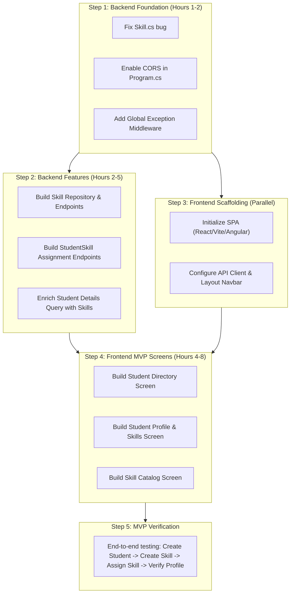

# Student & Skill Management System
## System Specification: Current State, MVP Scope & Future Roadmap

---

## 1. Current Situation (As-Is State)

### 1.1 Backend State
| Area | Status | Details |
|---|---|---|
| **Architecture** | Ready | Clean Architecture (`Domain`, `Application`, `Infrastructure`, `Presentation`) with CQRS handler pattern. |
| **Students Module** | **~75% Done** | - Domain entity [`Student`](file:///c:/ITI/StudentManagementApp/StudentMnagementApp/StudentManagement.Domain/Entities/Student/Student.cs) is complete.<br>- Basic CRUD commands/queries exist.<br>- [`StudentsController`](file:///c:/ITI/StudentManagementApp/StudentMnagementApp/StudentManagement.Presentation/Controllers/StudentsController.cs) provides: `POST /api/students`, `GET /api/students/{id}`, `GET /api/students`, `PUT /api/students/{id}`, `PATCH /api/students/{id}/status`.<br>- *Missing*: Does not return student skills in query responses, lacks search/pagination. |
| **Skills Module** | **~15% Done** | - Entity [`Skill`](file:///c:/ITI/StudentManagementApp/StudentMnagementApp/StudentManagement.Domain/Entities/Skill/Skill.cs) exists in Domain, but has a **critical bug**: line 32 calls `SetName(Name)` instead of `SetName(name)`, throwing an exception on every creation attempt.<br>- *Missing*: No repository, no CQRS handlers, no API endpoints. |
| **Student-Skills Module** | **~15% Done** | - Entity [`StudentSkill`](file:///c:/ITI/StudentManagementApp/StudentMnagementApp/StudentManagement.Domain/Entities/StudentSkill/StudentSkill.cs) and enum [`ProficiencyLevel`](file:///c:/ITI/StudentManagementApp/StudentMnagementApp/StudentManagement.Domain/Entities/StudentSkill/ProficiencyLevel.cs) (Beginner, Intermediate, Advanced, Expert) exist in Domain and EF Core.<br>- *Missing*: No way to assign, update, remove, or view skills for a student via the API. |
| **Cross-Cutting Concerns** | **Missing** | - **No CORS**: Any frontend running on `localhost` will be blocked by browsers.<br>- **No Global Exception Handling**: Errors return raw 500 errors instead of structured responses.<br>- **No Pagination/Filtering**: `GetAll` dumps the whole database into memory. |

### 1.2 Frontend State
| Area | Status | Details |
|---|---|---|
| **Client Application** | **0% (Not Started)** | No frontend project exists yet in the workspace. |

---

## 2. MVP Scope (Minimum Viable Product)

> **MVP Goal**: Deliver a fully working, connected end-to-end web system where an admin can:
> 1. Manage Students (create, view, update profile, toggle active/inactive).
> 2. Manage a Skill Catalog (create skills, view list, toggle active/inactive).
> 3. Assign Skills to Students with Proficiency Levels (Beginner, Intermediate, Advanced, Expert) and update/remove them.
> 4. View a Student's full profile displaying all their assigned skills and proficiency levels.

---

### 2.1 Backend MVP Features

The backend team needs to complete the following 4 core feature sets:

#### Feature B-1: Frontend Enablers (Fixes & CORS)
- **B-1.1**: Fix bug in [`Skill.cs`](file:///c:/ITI/StudentManagementApp/StudentMnagementApp/StudentManagement.Domain/Entities/Skill/Skill.cs#L32) (`SetName(name)`).
- **B-1.2**: Enable CORS in [`Program.cs`](file:///c:/ITI/StudentManagementApp/StudentMnagementApp/StudentManagement.Presentation/Program.cs) to allow the frontend dev server (e.g., `http://localhost:5173` or `http://localhost:3000`).
- **B-1.3**: Add basic Global Exception Handling middleware returning standard ProblemDetails (400 Bad Request, 404 Not Found, 409 Conflict).

#### Feature B-2: Skills Catalog API
Create complete CRUD for skills:
- **`GET /api/skills`**: Return list of skills (optional filter `?isActive=true`).
- **`GET /api/skills/{id}`**: Return single skill details.
- **`POST /api/skills`**: Create new skill (`name`, `description`).
- **`PUT /api/skills/{id}`**: Update skill name and description.
- **`PATCH /api/skills/{id}/status`**: Toggle skill status (`isActive: true/false`).

#### Feature B-3: Student-Skill Assignment API
Allow linking students with skills and tracking proficiency:
- **`GET /api/students/{id}/skills`**: Get all skills assigned to a student (Skill ID, Skill Name, Proficiency Level integer & name).
- **`POST /api/students/{id}/skills`**: Assign a skill to a student:
  - Payload: `{ skillId: Guid, proficiencyLevel: 1 | 2 | 3 | 4 }`
  - Validates skill is active, student is active, and relation doesn't already exist.
- **`PUT /api/students/{id}/skills/{skillId}`**: Update proficiency level:
  - Payload: `{ proficiencyLevel: 1 | 2 | 3 | 4 }`
- **`DELETE /api/students/{id}/skills/{skillId}`**: Remove skill from student.

#### Feature B-4: Enhanced Student Queries
- **B-4.1**: Update `GET /api/students/{id}` response to include the student's assigned skills.
- **B-4.2**: Add basic search and status filter to `GET /api/students` (`?search=john&isActive=true`).

---

### 2.2 Frontend MVP Features

The frontend team needs to build a modern SPA with 3 main screens and a shared layout:

#### Screen F-1: Student Directory (`/students`)
- **Student Table / List**:
  - Columns: Full Name, Email, Status Badge (Active/Inactive), Count of Skills, Actions.
  - Quick Search bar (filters by name or email).
  - Status Filter tabs (All, Active, Inactive).
- **Add Student Modal / Dialog**:
  - Fields: First Name, Last Name, Email.
  - Client-side validation: Required fields, valid email format.
- **Quick Status Toggle**:
  - One-click Activate / Deactivate button per student with confirmation.
- **Navigation Action**:
  - Clicking any student row opens their details screen.

#### Screen F-2: Student Details & Skill Profile (`/students/:id`)
- **Student Information Card**:
  - Display Full Name, Email, Status badge, ID.
  - "Edit Profile" button to update First Name, Last Name, Email.
- **Student Skills Section**:
  - Visual cards or table showing each assigned skill:
    - Skill Name
    - Proficiency Level Badge:
      - 🟢 Beginner (Level 1)
      - 🔵 Intermediate (Level 2)
      - 🟣 Advanced (Level 3)
      - 🟡 Expert (Level 4)
  - **"Assign New Skill" Action**:
    - Opens modal with a dropdown of available skills from the Skill Catalog.
    - Proficiency level selector (Beginner / Intermediate / Advanced / Expert).
  - **Edit Proficiency Action**:
    - Change level directly via dropdown or modal.
  - **Remove Skill Action**:
    - Delete button with confirmation prompt ("Remove C# from this student?").

#### Screen F-3: Skill Catalog (`/skills`)
- **Skill List Table**:
  - Columns: Skill Name, Description, Status (Active/Inactive), Actions.
- **Add Skill Modal**:
  - Fields: Skill Name (required), Description (optional).
- **Edit Skill Modal**:
  - Update Name and Description.
- **Toggle Skill Status**:
  - Activate or Deactivate skill.

#### Shared Frontend Infrastructure
- **Navigation Layout**: Clean sidebar or top navbar with links to **Students** and **Skills**.
- **API Client**: Centralized Axios/fetch instance using environment base URL.
- **Toast Notifications**: Feedback on every action (e.g., "Student added successfully", "Proficiency updated").
- **Empty States & Spinners**: Visual loaders during API requests and friendly empty states when tables have no items.

---

## 3. MVP API Contract (Backend <-> Frontend Sync)

| Method | Endpoint | Request Body | Response Body | HTTP Status |
|---|---|---|---|---|
| **GET** | `/api/students` | None (Optional `?search=&isActive=`) | `List<StudentDto>` | `200 OK` |
| **GET** | `/api/students/{id}` | None | `StudentDetailsWithSkillsDto` | `200 OK` / `404` |
| **POST** | `/api/students` | `{ firstName, lastName, email }` | `{ id }` | `201 Created` / `400` |
| **PUT** | `/api/students/{id}` | `{ firstName, lastName, email }` | None | `204 NoContent` / `400` / `404` |
| **PATCH** | `/api/students/{id}/status` | `{ isActive }` | None | `204 NoContent` / `404` |
| **GET** | `/api/students/{id}/skills` | None | `List<StudentSkillDto>` | `200 OK` / `404` |
| **POST** | `/api/students/{id}/skills` | `{ skillId, proficiencyLevel }` | None | `201 Created` / `400` / `404` |
| **PUT** | `/api/students/{id}/skills/{skillId}` | `{ proficiencyLevel }` | None | `204 NoContent` / `400` / `404` |
| **DELETE** | `/api/students/{id}/skills/{skillId}` | None | None | `204 NoContent` / `404` |
| **GET** | `/api/skills` | None (Optional `?isActive=`) | `List<SkillDto>` | `200 OK` |
| **GET** | `/api/skills/{id}` | None | `SkillDto` | `200 OK` / `404` |
| **POST** | `/api/skills` | `{ name, description }` | `{ id }` | `201 Created` / `400` |
| **PUT** | `/api/skills/{id}` | `{ name, description }` | None | `204 NoContent` / `400` / `404` |
| **PATCH** | `/api/skills/{id}/status` | `{ isActive }` | None | `204 NoContent` / `404` |

---

## 4. Post-MVP Features (What to Continue On Next)

Once the MVP is functional and verified, the following features will be added in subsequent iterations:

```
MVP (Phase 1) ──────────► Phase 2 (Enhancements) ──────────► Phase 3 (Intelligence & Security)
• Student CRUD           • Dashboard & Charts               • Skill Matcher / Talent Search
• Skill Catalog          • Pagination & Server Sorting      • Role-Based Access (Admin/Mentor/Student)
• Skill Assignment       • Skill Categories (Tracks)        • Student Self-Service Portal
• Proficiency Badges     • Audit Logs (CreatedAt/Modified)  • Export to PDF / Excel CV
```

### Phase 2: User Experience & Scale
1. **Dashboard & Analytics Screen (`/dashboard`)**:
   - Total students counter, active percentage.
   - Skill distribution chart (e.g., bar chart showing top skills across students).
   - Recent student assignments.
2. **Server-Side Pagination & Sorting**:
   - Replace simple list fetching with `PagedResult<T>` (`pageIndex`, `pageSize`, `totalPages`, `totalCount`).
   - Column sorting in data tables (sort by Name, Date, Skill Count).
3. **Skill Categories / Specialization Tracks**:
   - Categorize skills (e.g., *Frontend*, *Backend*, *Cloud / DevOps*, *Mobile*, *Soft Skills*).
   - Filter skill catalog and student profile by category.
4. **Audit Logging**:
   - Track `CreatedAtUtc`, `ModifiedAtUtc`, and who modified the student or skill proficiency.

### Phase 3: Strategic & Enterprise Capabilities
1. **Talent Matcher / Skill Matrix Tool (`/talent-matcher`)**:
   - Filter students by multiple required skills and minimum proficiency levels (e.g., find students where `C# >= Intermediate` AND `Angular >= Beginner`).
   - Match percentage indicator for student project assignments or hiring partners.
2. **Authentication, Authorization & Roles**:
   - Identity management (ASP.NET Core Identity + JWT Bearer).
   - Roles:
     - `Admin`: Full access to students, skills, and configuration.
     - `Instructor / Mentor`: Can view students and update skill proficiencies.
     - `Student`: Read-only view of own profile and skills.
3. **Student Self-Service Portal**:
   - Students can log in, view their own profile, and request skill endorsements or updates.
4. **Export & Reporting**:
   - Export student skill profiles to PDF (resume summary) or CSV/Excel for batch reporting.

---

## 5. Development Action Plan


