# Student & Skill Management System
## System Specification: Current State, MVP Scope & Future Roadmap

> **Last Updated**: November 16, 2026  
> **Backend Architecture**: ASP.NET Core Web API (Clean Architecture + CQRS + EF Core + ASP.NET Core Identity)  
> **Database**: SQL Server / LocalDB  

---

## 1. Project Roadmap Progress & Status Overview

```mermaid
flowchart LR
    M1["1. Core Backend CRUD<br/>(Students & Skills)"]
    M2["2. Student-Skill Relations<br/>(Proficiencies & Queries)"]
    M3["3. Security & Auth<br/>(Identity, JWT, Refresh Tokens)"]
    M4["4. Global Error Handling<br/>(Exception Middleware)"]
    M5["5. Frontend Client SPA<br/>(React / Angular / Vite)"]
    M6["6. End-to-End MVP Release<br/>(Testing & Integration)"]

    style M1 fill:#22c55e,stroke:#15803d,color:#fff
    style M2 fill:#22c55e,stroke:#15803d,color:#fff
    style M3 fill:#22c55e,stroke:#15803d,color:#fff
    style M4 fill:#f59e0b,stroke:#d97706,color:#fff
    style M5 fill:#ef4444,stroke:#b91c1c,color:#fff
    style M6 fill:#64748b,stroke:#475569,color:#fff

    M1 --> M2 --> M3 --> M4 --> M5 --> M6
```



### Executive Status Summary
- **Backend MVP Scope**: **~95% Completed** (All core domain entities, repositories, CQRS commands/queries, API endpoints, CORS, and full Identity/JWT/Refresh Token authentication are live; Global Exception Middleware remains).
- **Frontend MVP Scope**: **0% (Ready to Begin)** (API contracts and documentation are prepared; client project needs initialization).
- **Overall MVP Progress**: **~50%** (Backend foundation is rock-solid and ahead of schedule with Phase 3 Auth fast-tracked).

---

## 2. Current Situation (As-Is State - Verified November 2026)

### 2.1 Backend State
| Area | Status | Verified Implementation Details |
|---|---|---|
| **Architecture** | ✅ **Complete** | Clean Architecture (`Domain`, `Application`, `Infrastructure`, `Presentation`) with CQRS handler pattern and EF Core repository layer. |
| **Students Module** | ✅ **100% Done** | - [`Student`](file:///c:/ITI/StudentManagementApp/StudentMnagementApp/StudentManagement.Domain/Entities/Student/Student.cs) domain entity with full validation.<br>- Full CRUD commands and queries implemented.<br>- Query responses return full student details **with assigned skills** and proficiency labels.<br>- `GetAll` includes search filtering (`searchTerm` on Name & Email) and status filtering (`isActive`).<br>- Secured via `[Authorize]` JWT Bearer attribute. |
| **Skills Module** | ✅ **100% Done** | - [`Skill`](file:///c:/ITI/StudentManagementApp/StudentMnagementApp/StudentManagement.Domain/Entities/Skill/Skill.cs) domain bug fixed (`SetName(name)`).<br>- [`SkillRepository`](file:///c:/ITI/StudentManagementApp/StudentMnagementApp/StudentManagement.Infrastructure/Repositories/SkillRepository.cs) implemented.<br>- Full CQRS: Create, Update, Toggle Status, GetById, GetAll.<br>- [`SkillsController`](file:///c:/ITI/StudentManagementApp/StudentMnagementApp/StudentManagement.Presentation/Controllers/SkillsController.cs) public endpoints verified. |
| **Student-Skills Module** | ✅ **100% Done** | - [`StudentSkill`](file:///c:/ITI/StudentManagementApp/StudentMnagementApp/StudentManagement.Domain/Entities/StudentSkill/StudentSkill.cs) entity and [`ProficiencyLevel`](file:///c:/ITI/StudentManagementApp/StudentMnagementApp/StudentManagement.Domain/Entities/StudentSkill/ProficiencyLevel.cs) enum (Beginner, Intermediate, Advanced, Expert).<br>- Full CQRS commands: Assign skill, update proficiency level, remove skill.<br>- CQRS query: Get all skills for student.<br>- Endpoints live under `/api/students/{studentId}/skills`. |
| **Authentication & Security** | ✅ **100% Done** *(Fast-tracked from Phase 3)* | - ASP.NET Core Identity integration with `ApplicationUser`.<br>- JWT Bearer authentication with configurable secret key, issuer, and audience (60-minute expiry).<br>- Cryptographically secure Refresh Token system (7-day expiry) with token hashing (SHA-256), token rotation, and reuse detection (token family invalidation).<br>- Concurrency token row version migration applied to database.<br>- [`AuthController`](file:///c:/ITI/StudentManagementApp/StudentMnagementApp/StudentManagement.Presentation/Controllers/AuthController.cs) provides `/api/auth/register`, `/api/auth/login`, `/api/auth/refresh`, and `/api/auth/logout`.<br>- Swagger UI configured with Bearer token authentication support. |
| **CORS Policy** | ✅ **Complete** | Policy `"FrontendPolicy"` registered and active in `Program.cs` allowing any origin, method, and header. |
| **Global Exception Handling** | ⏳ **Pending** | `// To be done: Add global exception middleware` noted in `Program.cs`. Custom ProblemDetails formatting needed for domain exceptions. |

### 2.2 Frontend State
| Area | Status | Details |
|---|---|---|
| **Client Application** | ⏳ **0% (Not Started)** | No frontend directory or project setup yet. API documentation ready at [`API_DOCUMENTATION_FOR_FRONTEND.md`](file:///c:/ITI/StudentManagementApp/StudentMnagementApp/API_DOCUMENTATION_FOR_FRONTEND.md). |

---

## 3. Detailed MVP Feature Checklist

### 3.1 Backend Features

| ID | Feature Description | Status | Reference Files |
|---|---|---|---|
| **B-1.1** | Fix bug in `Skill.cs` (`SetName(name)`) | ✅ Done | `StudentManagement.Domain/Entities/Skill/Skill.cs` |
| **B-1.2** | Enable CORS in `Program.cs` (`FrontendPolicy`) | ✅ Done | `StudentManagement.Presentation/Program.cs` |
| **B-1.3** | Add Global Exception Handling Middleware | ⏳ Pending | `StudentManagement.Presentation/Program.cs` |
| **B-2.1** | `GET /api/skills` (List catalog skills) | ✅ Done | `SkillsController.cs`, `GetAllSkillsQueryHandler.cs` |
| **B-2.2** | `GET /api/skills/{id}` (Single skill details) | ✅ Done | `SkillsController.cs`, `GetSkillByIdQueryHandler.cs` |
| **B-2.3** | `POST /api/skills` (Create skill) | ✅ Done | `SkillsController.cs`, `CreateSkillCommandHandler.cs` |
| **B-2.4** | `PUT /api/skills/{id}` (Update skill) | ✅ Done | `SkillsController.cs`, `UpdateSkillCommandHandler.cs` |
| **B-2.5** | `PATCH /api/skills/{id}/status` (Toggle active/inactive) | ✅ Done | `SkillsController.cs`, `ChangeSkillStatusCommandHandler.cs` |
| **B-3.1** | `GET /api/students/{id}/skills` (List student's skills) | ✅ Done | `StudentsController.cs`, `GetAllStudentSkillsQueryHandler.cs` |
| **B-3.2** | `POST /api/students/{id}/skills` (Assign skill + proficiency) | ✅ Done | `StudentsController.cs`, `AssignSkillToStudentCommandHandler.cs` |
| **B-3.3** | `PUT /api/students/{id}/skills/{skillId}` (Update proficiency) | ✅ Done | `StudentsController.cs`, `UpdateProficiencyLevelCommandHandler.cs` |
| **B-3.4** | `DELETE /api/students/{id}/skills/{skillId}` (Remove skill) | ✅ Done | `StudentsController.cs`, `DeleteStudentSkillCommandHandler.cs` |
| **B-4.1** | Include assigned skills in `GET /api/students/{id}` response | ✅ Done | `GetStudentByIdQueryHandler.cs` |
| **B-4.2** | Add `searchTerm` & `isActive` filters in `GET /api/students` | ✅ Done | `GetAllStudentsQueryHandler.cs`, `StudentRepository.cs` |
| **B-Sec.1**| User Registration (`POST /api/auth/register`) | ✅ Done | `AuthController.cs`, `RegisterCommandHandler.cs` |
| **B-Sec.2**| User Login (`POST /api/auth/login`) | ✅ Done | `AuthController.cs`, `LoginCommandHandler.cs` |
| **B-Sec.3**| Refresh Token Rotation (`POST /api/auth/refresh`) | ✅ Done | `AuthController.cs`, `RefreshCommandHandler.cs` |
| **B-Sec.4**| Logout / Revoke Token (`POST /api/auth/logout`) | ✅ Done | `AuthController.cs`, `RevokeRefreshTokenCommandHandler.cs` |

---

### 3.2 Frontend MVP Features (Immediate Next Phase)

The frontend client will consume the backend API according to [`API_DOCUMENTATION_FOR_FRONTEND.md`](file:///c:/ITI/StudentManagementApp/StudentMnagementApp/API_DOCUMENTATION_FOR_FRONTEND.md):

#### F-0: Frontend Project Infrastructure
- [ ] Initialize SPA (Vite + React / Angular / Vue with TypeScript).
- [ ] Setup UI component library / Tailwind CSS.
- [ ] Configure Axios / Fetch API client with base URL (`https://localhost:7044`) and JWT Bearer request interceptor.
- [ ] Setup Axios response interceptor for automatic `/api/auth/refresh` on 401 Unauthorized.
- [ ] Client-side state/auth context to manage user session and active tokens.

#### F-1: Authentication Screens (`/login`, `/register`)
- [ ] **Login Screen**: Email & password inputs, remember me, error banners, redirect to `/students`.
- [ ] **Register Screen**: Email & password validation (matching backend rules: upper, lower, digit, special character).

#### F-2: Student Directory Screen (`/students`)
- [ ] **Student Table / Grid**:
  - Columns: Full Name, Email, Status Badge (Active/Inactive), Skills Pill Count, Action Buttons.
  - Quick Search bar (filters by name or email).
  - Status Filter tabs (All, Active, Inactive).
- [ ] **Add Student Modal / Dialog**:
  - Fields: First Name, Last Name, Email.
  - Validation: Required, valid email.
- [ ] **Status Toggle**:
  - One-click Activate / Deactivate button with confirmation prompt.
- [ ] **Row Click**:
  - Navigates to `/students/:id`.

#### F-3: Student Details & Skill Profile Screen (`/students/:id`)
- [ ] **Student Info Header**:
  - Name, Email, Status, Edit Profile modal.
- [ ] **Skills Matrix**:
  - Cards or table displaying each assigned skill with badge:
    - 🟢 Beginner (1)
    - 🔵 Intermediate (2)
    - 🟣 Advanced (3)
    - 🟡 Expert (4)
- [ ] **Assign Skill Modal**:
  - Dropdown of active catalog skills (from `GET /api/skills`).
  - Proficiency level picker.
- [ ] **Change Proficiency Modal / Inline Selector**:
  - Change level 1–4.
- [ ] **Remove Skill Button**:
  - With confirmation modal.

#### F-4: Skill Catalog Screen (`/skills`)
- [ ] **Catalog Table**:
  - Skill Name, Description, Status (Active/Inactive), Actions.
- [ ] **Create Skill Modal**:
  - Name (required), Description (optional).
- [ ] **Edit Skill Modal**:
  - Update Name & Description.
- [ ] **Toggle Skill Status**:
  - Activate / Deactivate.

---

## 4. MVP API Contract Overview

| Method | Endpoint | Auth | Purpose | Status |
|---|---|---|---|---|
| **POST** | `/api/auth/register` | ❌ Public | Register user & receive JWT + Refresh Token | ✅ Live |
| **POST** | `/api/auth/login` | ❌ Public | Login & receive JWT + Refresh Token | ✅ Live |
| **POST** | `/api/auth/refresh` | ❌ Public | Rotate refresh token & get fresh access token | ✅ Live |
| **POST** | `/api/auth/logout` | ❌ Public | Revoke refresh token | ✅ Live |
| **GET** | `/api/skills` | ❌ Public | List skill catalog | ✅ Live |
| **GET** | `/api/skills/{id}` | ❌ Public | Get skill by ID | ✅ Live |
| **POST** | `/api/skills` | ❌ Public | Create skill | ✅ Live |
| **PUT** | `/api/skills/{id}` | ❌ Public | Update skill | ✅ Live |
| **PATCH** | `/api/skills/{id}/status` | ❌ Public | Toggle active/inactive skill | ✅ Live |
| **GET** | `/api/students?searchTerm=&isActive=` | 🔒 Bearer | List students with skills + search/filter | ✅ Live |
| **GET** | `/api/students/{id}` | 🔒 Bearer | Get student profile with assigned skills | ✅ Live |
| **POST** | `/api/students` | 🔒 Bearer | Create new student | ✅ Live |
| **PUT** | `/api/students/{id}` | 🔒 Bearer | Update student profile | ✅ Live |
| **PATCH** | `/api/students/{id}/status` | 🔒 Bearer | Toggle active/inactive student | ✅ Live |
| **GET** | `/api/students/{id}/skills` | 🔒 Bearer | Get skills of a student | ✅ Live |
| **POST** | `/api/students/{id}/skills` | 🔒 Bearer | Assign skill to student (proficiency 1–4) | ✅ Live |
| **PUT** | `/api/students/{id}/skills/{skillId}` | 🔒 Bearer | Update skill proficiency | ✅ Live |
| **DELETE** | `/api/students/{id}/skills/{skillId}` | 🔒 Bearer | Remove skill from student | ✅ Live |

---

## 5. Post-MVP Roadmap (Future Phases)

```
MVP (Phase 1) ─────────────────► Phase 2 (UX & Scale) ─────────────► Phase 3 (Intelligence & Enterprise)
• Students CRUD (Done)          • Dashboard & Analytics           • Skill Matcher / Talent Search
• Skill Catalog (Done)          • Pagination & Server Sorting     • Role-Based Access (Admin/Mentor/Student)
• Skill Assignment (Done)       • Skill Categories (Tracks)       • Student Self-Service Portal
• Auth & JWT (Done)             • Audit Logs (CreatedAt/By)       • Export to PDF / Excel CV
• Global Exception Middleware   • Batch Operations                • Notification Webhooks
• Frontend Client SPA (Next)
```

### Phase 2: User Experience & Scale
1. **Dashboard & Analytics Screen (`/dashboard`)**:
   - Total students counter, active percentage, skills distribution chart.
2. **Server-Side Pagination & Sorting**:
   - Replace list returns with `PagedResult<T>` (`pageIndex`, `pageSize`, `totalPages`, `totalCount`).
   - Add column sorting (by Name, Date, Skill count).
3. **Skill Categories / Specialization Tracks**:
   - Categorize skills (Frontend, Backend, DevOps, Data, Mobile).
4. **Audit Logging**:
   - Track `CreatedAtUtc`, `ModifiedAtUtc`, and modified-by user IDs across entities.

### Phase 3: Strategic & Enterprise Capabilities
1. **Talent Matcher / Skill Matrix Tool (`/talent-matcher`)**:
   - Multi-criteria filter: find students meeting combination of skills & minimum proficiency (e.g. `C# >= Advanced` AND `Angular >= Intermediate`).
2. **Fine-Grained Role-Based Access Control (RBAC)**:
   - Expand existing Identity roles (`Admin`, `Instructor`, `Student`) into endpoint policies.
3. **Student Self-Service Portal**:
   - Students view their own profile and request skill endorsements.
4. **Resume & CV Export**:
   - Generate PDF student skill profile resumes.

---

## 6. Immediate Next Steps / Action Items

1. **Backend Polishing (Remaining 5%)**:
   - Implement Global Exception Handling Middleware in `Presentation` returning RFC 7807 `ProblemDetails` for validation and domain exceptions.
2. **Frontend Initialization (Immediate Priority)**:
   - Initialize the frontend project (e.g., `client` or `frontend` directory).
   - Configure HTTP client with interceptors for JWT Bearer token and automatic refresh token rotation.
   - Build Authentication screens (`/login`, `/register`).
   - Build Student Directory, Student Profile, and Skill Catalog screens.
3. **End-to-End Verification**:
   - Verify complete user journey: Register -> Login -> Create Student -> Create Skill -> Assign Skill -> Update Proficiency -> Refresh Token -> Logout.
